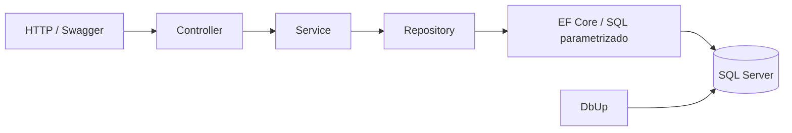

# Property Maintenance API

API REST de inmuebles, contratos, solicitudes de mantenimiento y visitas: ocho endpoints, .NET 10 y SQL Server. El [enunciado original](docs/ORIGINAL_CHALLENGE.md) se conserva íntegro en un archivo separado.

**Entrega: CONDITIONAL.** Los reportes manuales mantienen nueve incumplimientos conocidos. HTTP 200 acredita ejecución técnica, no exactitud de sus indicadores. Azure SQL, visibilidad pública y CI remota requieren evidencia adicional. Véase la [auditoría](docs/TECHNICAL_AUDIT.md).

## Stack y arquitectura

| Componente | Versión/configuración |
|---|---|
| API y dos proyectos de pruebas | net10.0 |
| EF Core SqlServer / Design / dotnet-ef | 10.0.7; Database First y herramienta local |
| SQL Server | 2022 Developer en Docker, schema dbo |
| DbUp | 5.0.40; ocho migraciones embebidas, sin migraciones EF |
| OpenAPI / Swagger UI | Generador nativo .NET 10 / UI 7.2.0 |
| Pruebas | xUnit 2.9.3, WebApplicationFactory, SQL Server real |
| Docker | SDK y runtime ASP.NET 10.0; parches observados en auditoría |



Controllers delgados, reglas/transacciones en servicios y repositorios específicos. Entidades EF, modelos de negocio y DTOs separados mediante mapeo explícito. Sin proyectos adicionales, MediatR, AutoMapper o repositorio genérico.

## Instalación desde cero

Requisitos: Git y Docker con Compose v2, contenedores Linux y recursos suficientes para SQL Server/.NET. En Windows, iniciar Docker Desktop. No se necesita instalar .NET, SQL Server ni EF en el host.

1. Clonar el enlace entregado por el desarrollador y entrar en la raíz del repositorio.
2. Crear `.env` **sólo si todavía no existe**:

   ```powershell
   # Windows PowerShell
   Copy-Item .env.example .env
   ```

   ```bash
   # Linux/macOS
   cp .env.example .env
   ```

3. Editar `.env`: elegir una contraseña local propia conforme a la política SQL Server. Para este formato de connection string usar letras, dígitos y símbolos simples `_`/`!`, sin `;`, comillas o `$`. No versionar `.env`. El fallback público del template sólo se conserva por compatibilidad local, no para producción. Estas instrucciones asumen un volumen nuevo: si se conserva un volumen anterior, configurar su contraseña existente o cambiarla conscientemente dentro de SQL Server; editar la variable no cambia la credencial persistida. Para una instalación paralela, usar proyecto y volúmenes nuevos.

| Variable | Uso |
|---|---|
| DB_PASSWORD | Contraseña SQL local, compartida por servidor y conexiones |
| DB_NAME | Base demo nueva; no reutilizar una base ajena sin journal |
| TEST_DATABASE_NAME | Base aislada con prefijo PropertyMaintenanceDb_T04_ |
| DB_PORT | SQL desde host: localhost,1433 por defecto |
| APP_PORT | API iniciada dentro de dev: 8080 por defecto |
| API_PORT | API publicada: 8081 por defecto |
| SEED_DEMO_DATA | true: demo; false: sólo esquema/catálogos |
| COMPOSE_PROJECT_NAME | Opcional: otro nombre para copias/volúmenes aislados |

Para revisar junto a una instalación existente, elegir otro COMPOSE_PROJECT_NAME y puertos libres en esa copia. Como protección adicional, usar `docker compose -p propertymaintenance-evaluation` en lugar de `docker compose` en **todos** los comandos de esa revisión. El nombre explícito evita reutilizar el proyecto/volúmenes del desarrollador incluso si falta una variable de .env. No usar los volúmenes existentes.

4. Iniciar y esperar el healthcheck:

   ```bash
   docker compose up -d --wait db dev
   ```

5. Aprovisionar bases, separado de DbUp:

   ```bash
   docker compose exec -T db bash /opt/propertymaintenance/scripts/provision-database.sh
   docker compose exec -T db bash /opt/propertymaintenance/scripts/provision-database.sh PropertyMaintenanceDb_T04_Integration
   ```

   Sustituir el segundo nombre si se cambió TEST_DATABASE_NAME. El script valida nombres y crea sólo bases inexistentes; nunca elimina ni sobrescribe datos. Una base con objetos y sin journal no recibe un baseline ficticio.

6. Iniciar **uno de estos modos**:

   API publicada, contenedor sin SDK:

   ```bash
   docker compose --profile api up -d --build api
   docker compose logs api
   ```

   Esperar en logs el mensaje `Now listening` después de DbUp/seed. Swagger: **http://localhost:8081/swagger/index.html**. Documento: http://localhost:8081/openapi/v1.json. Sustituir el puerto si cambió API_PORT.

   Desarrollo existente, SDK/código compartido:

   ```bash
   docker compose exec -T dev dotnet run --project src/PropertyMaintenance.Api --no-launch-profile --urls http://0.0.0.0:8080
   ```

   Swagger: **http://localhost:8080/swagger/index.html**. Mantener la terminal abierta; Ctrl+C detiene esa ejecución. No iniciar otra API dentro de dev sobre el mismo puerto. El servicio publicado usa otro contenedor/puerto y no elimina el flujo dev.

Dentro de Docker el servidor es `db,1433`; desde SSMS, `localhost,<DB_PORT>`, usuario local sa y contraseña de `.env`. Los puertos son locales al host. Cambiar una contraseña en `.env` después de inicializar el volumen no cambia la contraseña persistida por SQL Server.

## Inicialización, configuración y seed

DbUp aplica 001–008 antes de aceptar peticiones y registra dbo.SchemaVersions. Los SP canónicos de database/scripts se embeben como 006/007, sin copias editables. El seed usa una transacción y dbo.DemoSeedVersions: repetir el arranque no duplica ni actualiza fechas. Una base con datos ajenos y sin journal del seed se rechaza.

EF/DbUp consumen ConnectionStrings:PropertyMaintenance. `Enlist=false` se rechaza antes de iniciar: las escrituras dependen de TransactionScope. Default/Enlist=true están soportados. Fechas contractuales inclusivas; eventos UTC y DATETIME2(3). La demo conserva su referencia UTC inicial, no rejuvenece automáticamente los datos al reiniciar.

El modo local usa Development para Swagger y demo. Para despliegues reales, aprovisionar previamente la base, controlar permisos DDL y deshabilitar demo; Swagger sólo está configurado en Development. No hay certificación de ejecución Azure ni autenticación dentro del alcance del ejercicio.

## Contratos de los ocho endpoints

JSON camelCase; enums como texto; IDs positivos. ProblemDetails para errores y 500 sin detalles internos ante fallos inesperados. Los DTOs de escritura rechazan campos internos/desconocidos.

| Método/ruta | Entrada y propósito | Éxito | Errores relevantes |
|---|---|---|---|
| POST /api/maintenance-requests | unitId, tenantId, category, priority, description; contrato vigente | 201, solicitud Open | 400 entrada, 404 unidad/inquilino, 409 sin contrato |
| POST /api/maintenance-requests/{id}/visits | technicianId, notes, cost; Assigned/InProgress, cualquier técnico activo | 201, visita | 400 importe/notas, 404, 409 estado/técnico inactivo |
| PATCH /api/maintenance-requests/{id}/status | status; technicianId sólo al asignar | 200, solicitud | 400 formato, 404, 409 transición/sin visitas/concurrencia |
| GET /api/properties/{id}/units | Todas las unidades, inquilino vigente o null | 200, incluso vacío | 400 ID, 404 edificio |
| GET /api/maintenance-requests | page=1, pageSize=20 (1–100), status, priority, propertyId, from, to | 200, metadatos/items | 400 filtros/rango/enum |
| GET /api/tenants/{id}/history | Contratos y solicitudes históricas con suma de visitas | 200 | 400 ID, 404 inquilino |
| GET /api/reports/properties-summary?from=&to= | Días obligatorios yyyy-MM-dd; to máximo9999-12-30 | 200, arreglo | 400 fechas; deuda de indicadores |
| GET /api/reports/technicians-workload | Sin parámetros HTTP; servicio envía AsOfUtc | 200, arreglo | Deuda de indicadores |

Category máximo100; Description/Notes máximo2000; no blancos, espacios exteriores recortados. Priority: Low/Medium/High/Urgent. Cost obligatorio, decimal(18,2), admite cero; rechaza negativos y escala excedida sin redondear. No se controla RequestId, VisitId, RowVersion o fechas desde el body.

Transiciones: Open→Assigned, Open→Cancelled, Assigned→InProgress, Assigned→Cancelled, InProgress→Closed. Sin reasignación/reapertura; cierre exige visita. Listado por CreatedAt DESC/RequestId DESC; from y to inclusivos por día UTC. Offset y consultas independientes tienen limitaciones ante cambios concurrentes. Historial suma todas las visitas por solicitud, sin multiplicarlas por contratos.

## Flujo completo en Swagger o curl

Consultar IDs vigentes del seed sin asumir que comienzan en1:

```bash
docker compose exec -T db bash /opt/propertymaintenance/scripts/demo-identifiers.sh
```

Abrir Swagger, usar esos UnitId/TenantId/PropertyId/TechnicianId y copiar el RequestId generado. En la base demo se agregarán datos; no usar una base productiva. El siguiente ejemplo es Bash: no pegar sus asignaciones/continuaciones directamente en PowerShell o CMD. En Windows se puede seguir el mismo flujo con Swagger; si se usa curl.exe, adaptar también el quoting y las continuaciones de la shell. Sustituir los marcadores antes de ejecutar y ajustar API_BASE al modo/puerto elegido.

```bash
API_BASE=http://localhost:8081
UNIT_ID=<unidad-vigente>
TENANT_ID=<inquilino-vigente>
PROPERTY_ID=<edificio>
TECHNICIAN_ID=<tecnico-activo>
curl -i -X POST "$API_BASE/api/maintenance-requests" -H 'Content-Type: application/json' \
  -d "{\"unitId\":$UNIT_ID,\"tenantId\":$TENANT_ID,\"category\":\"Plumbing\",\"priority\":\"High\",\"description\":\"Demo fixture\"}"
# 201, RequestId generado, Open, technicianId/closedAt null.
REQUEST_ID=<requestId-del-POST>
curl -i -X PATCH "$API_BASE/api/maintenance-requests/$REQUEST_ID/status" -H 'Content-Type: application/json' \
  -d "{\"status\":\"Assigned\",\"technicianId\":$TECHNICIAN_ID}"
curl -i -X PATCH "$API_BASE/api/maintenance-requests/$REQUEST_ID/status" -H 'Content-Type: application/json' -d '{"status":"InProgress"}'
curl -i -X POST "$API_BASE/api/maintenance-requests/$REQUEST_ID/visits" -H 'Content-Type: application/json' \
  -d "{\"technicianId\":$TECHNICIAN_ID,\"notes\":\"Demo visit\",\"cost\":12.34}"
# 200 Assigned, 200 InProgress, 201 visita con ID/fecha UTC.
curl -i -X PATCH "$API_BASE/api/maintenance-requests/$REQUEST_ID/status" -H 'Content-Type: application/json' -d '{"status":"Closed"}'
# 200 Closed, ClosedAt UTC y técnico conservado.
curl -i "$API_BASE/api/properties/$PROPERTY_ID/units"
curl -i "$API_BASE/api/tenants/$TENANT_ID/history"
curl -i "$API_BASE/api/maintenance-requests?page=1&pageSize=5&status=Closed&priority=High&propertyId=$PROPERTY_ID"
# 200; historial incluye costo12.34 para la solicitud nueva.
curl -i "$API_BASE/api/reports/properties-summary?from=2026-01-01&to=2026-12-31"
curl -i "$API_BASE/api/reports/technicians-workload"
# 200 no certifica indicadores. Ajustar el rango al año de referencia del seed.
curl -i -X POST "$API_BASE/api/maintenance-requests/$REQUEST_ID/visits" -H 'Content-Type: application/json' \
  -d "{\"technicianId\":$TECHNICIAN_ID,\"notes\":\"Rejected after close\",\"cost\":0}"
# 409 INVALID_VISIT_STATUS, sin visita nueva.
```

## Pruebas, validaciones SQL y publicación

La base TEST_DATABASE_NAME debe estar aprovisionada y aislada; su nombre requiere prefijo T04. Las pruebas inicializan DbUp/seed con SQL Server real. No comparten la base demo.

```bash
docker compose exec -T dev dotnet tool restore
docker compose exec -T dev dotnet restore PropertyMaintenance.slnx
docker compose exec -T dev dotnet build PropertyMaintenance.slnx -c Release
docker compose exec -T dev dotnet test PropertyMaintenance.slnx -c Release
docker compose exec -T dev dotnet list PropertyMaintenance.slnx package --vulnerable --include-transitive
docker compose exec -T dev dotnet publish src/PropertyMaintenance.Api/PropertyMaintenance.Api.csproj -c Release --output /tmp/propertymaintenance-publish
docker compose exec -T db bash /opt/propertymaintenance/scripts/validate-sql.sh PropertyMaintenanceDb_T04_Integration
```

Sustituir el argumento final si cambió TEST_DATABASE_NAME. El script SQL ejecuta ValidateSchema, ValidateConstraints, ValidateLeaseOverlap, ValidateSeed y ValidateReports. **Se espera código1/error51910 en reportes: seis PASS/nueve incumplimientos.** No añadir `|| true` ni tratarlo como aprobación funcional; los otros validadores deben terminar0.

Regeneración Database First, sólo después de un cambio SQL autorizado: `docker compose exec -T dev bash database/scaffold.sh`. Usa herramienta local, once tablas explícitas y --no-onconfiguring; no incluye journals. Revisar primero archivos generados frente a personalizaciones y pasar --force sólo tras esa revisión. No se necesita scaffold para ejecutar la aplicación.

## CI, parada y entrega

[GitHub Actions](.github/workflows/ci.yml) usa SQL Server real y Docker/dev para tool restore, restore, Release build, unitarias/integración, auditoría y publicación. Contraseña efímera, sin credenciales personales. Ejecución remota pendiente hasta push: la validación local no se presenta como CI remota aprobada.

Validación local T11 (2026-11-26): copia candidata sin artefactos previos,266 pruebas aprobadas (99 unitarias/167 integración), build/publish Release sin errores, NuGet sin vulnerabilidades reportadas, ambos modos Docker y los ocho endpoints ejercitados. ValidateReports continúa fallando con51910. Evidencia e incidente inicial de aislamiento/recuperación en auditoría sección16; no se afirma un clon remoto ni una aprobación de entrega pública.

Para detener sólo este proyecto sin borrar datos: `docker compose --profile api stop`. Los datos permanecen en el volumen. No ejecutar down -v sobre volúmenes del desarrollador. Las pruebas de migración retienen bases aisladas y requieren permisos locales de creación; cualquier eliminación debe seleccionarse/autorizarse expresamente.

El desarrollador debe revisar git diff, preparar un commit convencional, hacer push a dev e integrar a la rama principal mediante su flujo autorizado. Después comprobar Actions y abrir el enlace en sesión anónima para verificar acceso público antes de entregar. No se ejecutan esas operaciones automáticamente ni se cambia visibilidad, tags o releases. M37 sigue pendiente hasta evidencia real.

## Documentación y limitaciones

- [Enunciado original](docs/ORIGINAL_CHALLENGE.md), [decisiones/uso de IA](DECISIONES.md).
- [Requisitos](docs/REQUIREMENTS.md), [arquitectura](docs/ARCHITECTURE.md), [base de datos](docs/DATABASE.md), [backlog](docs/BACKLOG.md).
- [Auditoría, evidencia y propuestas pendientes](docs/TECHNICAL_AUDIT.md).

Los SP fueron escritos personalmente por el desarrollador y permanecen intactos. Deuda: poblaciones de fechas mezcladas, promedio entero, costos omitidos, técnicos sin carga ausentes, conteos/orden afectados por visitas y referencia temporal ignorada. No se corrige mediante C#. F07/F08/F10 fueron remediados por migración008, validador de journals y guard Enlist. Persisten limitaciones de fixtures/retención de bases y otras observaciones de auditoría. No hay autenticación ni certificación de exposición productiva. M02 sólo tiene revisión estática, no ejecución Azure. La entrega pública no está verificada.
